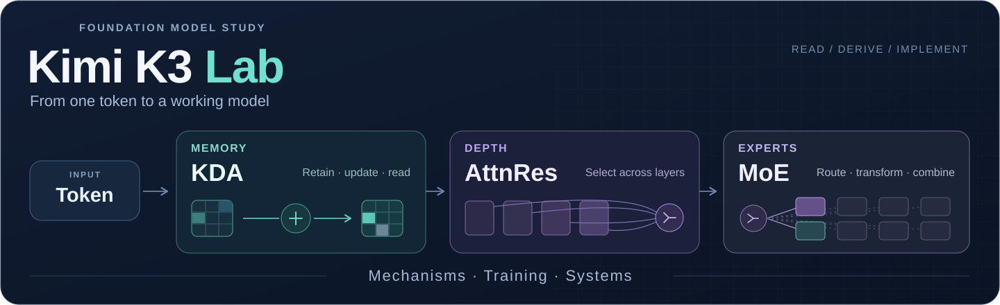

<h1 align="center">Kimi K3 · Deep Dive &amp; Lab</h1>
<p align="center"><strong>从基模的计算机制，到可运行的后训练实验。</strong></p>
<p align="center">
  <a href="docs/foundation-models/README.md">学习路线</a> ·
  <a href="docs/architecture.md">架构拆解</a> ·
  <a href="reports/mechanisms/REPORT.md">实验结果</a> ·
  <a href="docs/experiments.md">Agent Lab</a> ·
  <a href="docs/foundation-models/sources.md">官方原文</a>
</p>



一份面向基模研发学习的中文解读与实验仓库。沿着 **token → 记忆状态 → 跨层聚合 → 专家路由 → 训练目标 → 系统成本** 拆解 Kimi K3，把公式落到小规模参考实现，再用独立形式、干预实验和保存结果核对。

## 先看什么

| 机制与推导 | 训练与系统 |
| :--- | :--- |
| **[KDA：从 delta rule 到分块求解](docs/foundation-models/01-kda.md)**<br>二维手算、遗忘与写入、下三角系统、跨块状态续接 | **[预训练与系统](docs/foundation-models/04-pretraining-systems.md)**<br>数据与 scaling、Per-Head Muon、并行通信、混合精度与数值诊断 |
| **[AttnRes：沿深度做选择](docs/foundation-models/02-attnres.md)**<br>pseudo-query、key RMSNorm、Full/Block 与梯度路径 | **[后训练与策略蒸馏](docs/foundation-models/05-posttraining.md)**<br>SFT labels、策略比率、KL、MOPD 与长轨迹版本问题 |
| **[MoE：路由与负载](docs/foundation-models/03-moe.md)**<br>Top-k、selection bias、QB 阈值、dispatch/combine 与 latent 成本 | **[面试 walkthrough 与动手题](docs/foundation-models/06-interview-walkthrough.md)**<br>计算、代码、实验与工程取舍串成可追问的项目讲解 |

完整入口：[基模学习路线](docs/foundation-models/README.md) · [K3 架构总览](docs/architecture.md) · [逐节来源](docs/foundation-models/sources.md)。

## 在 CPU 上跑出第一份报告

无需 API Key 或模型权重：

```bash
git clone https://github.com/WonderfulClaire/kimi-k3-deep-dive.git
cd kimi-k3-deep-dive
python -m venv .venv
source .venv/bin/activate
python -m pip install -e ".[dev,mechanisms]"
PYTHONPATH=src python scripts/run_mechanism_lab.py --out reports/mechanisms
pytest -q
```

[已生成的中文报告](reports/mechanisms/REPORT.md) 与 [原始 JSON](reports/mechanisms/results.json) 保存输入、seed、配置和数值。你可以先预测，再修改一个条件，重新运行：

- **KDA**：逐 token 递推与真正的块内下三角求解是否一致？改动未来输入会不会污染过去输出？beta=0、beta=1 和逐通道遗忘分别发生什么？
- **AttnRes**：零 pseudo-query 为什么得到来源平均？来源做 key RMSNorm 后，value 的大小还会不会影响混合结果？Full 和 Block 的来源集合怎样不同？
- **MoE**：偏置为什么只进入专家选择？同批校准变均衡以后，换一批 token 会怎样？expert-major 分发能否与逐 token 标量参考对上？
- **系统账本**：稀疏激活、参数驻留和逻辑通信各花多少？循环状态固定以后，混合模型中的全局注意力缓存如何随序列长度增长？

这条路线验证小维度机制与数值行为。报告中的参数、缓存和 payload 公式各自注明假设，GPU 核函数速度与大模型训练收益另用实际工作负载测量。

## K3 在解决什么问题

| 方向 | 公开报告中的设计 | 本仓库的阅读出口 |
| --- | --- | --- |
| 序列 | KDA 与 Gated MLA 混合 | 记忆容量、因果分块、prefill / decode 的不同成本 |
| 深度 | Attention Residuals | 深度 softmax、来源聚合、Full / Block 的存储取舍 |
| 宽度 | Stable LatentMoE 与 Quantile Balancing | 路由分数、负载、潜在表示与专家并行 |
| 训练与部署 | Per-Head Muon、原生多模态、后训练 QAT | 优化器数值、token 加权、精度格式和运行状态分账 |

K3 v1 架构表列出 **2.78T 总参数、104.2B 激活参数、93 层、69 KDA + 24 MLA**。[规格与版本](docs/foundation-models/sources.md)固定回到官方原文；Kimi Linear 的独立效率实验单独归属。

## Agentic Post-Training Lab

保留现有实验链：**模型端点 → harness → 工具环境 → trajectory → verifier → reward → SFT / GRPO → held-out 评测**。

| 入口 | 能运行什么 |
| --- | --- |
| [实验协议](docs/experiments.md) | same-harness 评测、history 与工具 schema 消融、轨迹与 manifest |
| [训练说明](docs/training.md) | verified trajectories → LoRA SFT → environment-owned GRPO |
| [Bounded AutoResearch](docs/autoresearch.md) | dev allowlist 搜索、配置选择、一次 held-out harness 评测 |
| [Reward 与环境](src/k3lab/envs/minirepo.py) | public-test signal、原测试、held-out tests 与文件完整性分开检查 |

```bash
export K3LAB_API_KEY="..."
export K3LAB_BASE_URL="https://your-openai-compatible-endpoint/v1"
export K3LAB_MODEL="your-model"
k3lab-eval --tasks experiments/tasks/repo_patch.jsonl --out runs/your-model.jsonl
k3lab-export-sft runs/your-model.jsonl --out data/verified_sft.jsonl
```

端点实验使用你配置的模型与服务；训练入口和运行条件见对应文档。CPU 机制报告与模型训练/能力结果分别记录。

## 继续深入

- [API 上手](docs/getting-started.md) · [自部署](docs/self-hosting.md) · [评测导读](docs/benchmarks.md) · [局限与踩坑](docs/limitations.md)
- [代码目录](src/k3lab/) · [行为检查](tests/) · [贡献说明](CONTRIBUTING.md) · [MIT License](LICENSE)

This is an independent technical study and executable learning lab, combining source-grounded Chinese notes, NumPy mechanism references, and agentic post-training infrastructure.

