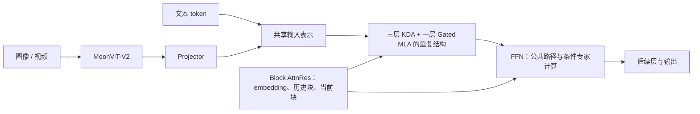

# Kimi K3 架构：从一次 token 计算到训练系统

Kimi K3 把三种信息流放在同一个主干里：KDA 与 Gated MLA 处理序列上的信息，Block Attention Residuals 处理深度上的信息，Stable LatentMoE 处理通道上的条件计算。理解它时，先跟踪一个 token 经过哪些张量，再讨论这些张量怎样在 GPU 上存放、计算和通信。

本文固定阅读 **Kimi K3 技术报告 v1，2026-07-27**；核对日期为 **2026-10-21**。公式编号指向该版本。[arXiv 版本页](https://arxiv.org/abs/2607.24653)另有 2026-08-07 的 v2，本文不把不同版本的内容混写。系统与训练预算继续读[预训练与系统讲义](foundation-models/04-pretraining-systems.md)，逐节来源见[来源表](foundation-models/sources.md)。

## 1. 先把模型规格与计算路径对上

技术报告 Table 1 给出的精确规格如下；“2.8T / 104B”是概述中的近似写法。[原文：§3.2、Table 1](https://arxiv.org/html/2607.24653v1#S3.SS2)

| 对象 | Kimi K3 v1 | 读这个数字时要问什么 |
| --- | --- | --- |
| 总参数（报告 Table 1） | 2.78T | 参数放在哪些设备，采用什么格式，是否包含额外副本？ |
| 每 token 激活参数 | 104.2B | 哪些矩阵参与这次计算，额外的路由、通信和访存花多少时间？ |
| 主干层数 | 93 | 不同层的注意力与 FFN 如何组成？ |
| 隐藏维度 | 7,168 | token 的公共表示有多宽？ |
| 路由专家的潜在维度 | 3,584 | 哪条路径先降维，哪些路径仍然全宽？ |
| 每个专家的 FFN 隐藏维度 | 3,072 | 专家数量、输入宽度和 FFN 内部宽度共同决定参数量 |
| 路由专家 / 每 token 选中数 | 896 / 16 | 负载分布怎样影响训练与执行？ |
| 共享专家 | 2 | 共享路径仍然参与每个 token 的计算 |
| 注意力头数 | 96 | 状态维度、头的分片与内核并行度怎样关联？ |
| 注意力层构成 | 69 KDA + 24 MLA | 全局注意力层保留了随上下文增长的成本 |
| Dense 层 / MTP 层 | 1 / 1 | 不应把所有 FFN 都画成同一种专家结构 |
| 词表 | 160K | token 数取决于分词器，不能由文本字符数直接替代 |
| 最长训练上下文 | 1M token | 长度课程、数据和并行共同使它可用 |
| MoonViT-V2 | 401M，27 层，patch size 14，12 个头 | 视觉编码器也有独立的计算和负载问题 |

注意力主干按“三层 KDA，接一层 Gated MLA”重复，最后额外加入一层 Gated MLA。因此局部周期为 3:1，**完整 93 层是 69:24**。原生视觉先通过 MoonViT-V2 与 projector 映射到共享表示，再进入主干。[原文：§2.1](https://arxiv.org/html/2607.24653v1#S2.SS1)、[§2.4](https://arxiv.org/html/2607.24653v1#S2.SS4)

图概括信息流；精确层次以原文 Figure 2 与 Table 1 为准。AttnRes 的聚合发生在模块输入处，不能把它理解为模型最后才调用的外部检索器。

## 2. KDA：更新一个有内容寻址能力的矩阵状态

### 2.1 从一个二维算例开始

只看一个头。设旧状态为单位矩阵，保留比例为 $(0.5,1)$，本次 key 为 $(1,0)$，value 为 $(3,4)$，写入强度为 $0.5$。先把旧状态的第一行衰减一半：

$$
\bar S=\operatorname{Diag}(0.5,1)I
=\begin{bmatrix}0.5&0\\0&1\end{bmatrix}.
$$

用当前 key 读取旧记忆，得到 $\bar S^\top k=(0.5,0)$；与当前 value 的差为 $(2.5,4)$。把这份差沿 key 方向写回：

$$
S=\bar S+0.5\begin{bmatrix}1\\0\end{bmatrix}
\begin{bmatrix}2.5&4\end{bmatrix}
=\begin{bmatrix}1.75&2\\0&1\end{bmatrix}.
$$

若 query 也是 $(1,0)$，输出就是 $S^\top q=(1.75,2)$。这个例子显示了三个不同操作：先遗忘，再比较旧预测与新 value，最后按差值更新。这里的二维数值是教学构造。

### 2.2 把操作写成一般公式

原文单头定义中，$q_t,k_t\in\mathbb R^{d_k}$，$v_t\in\mathbb R^{d_v}$，状态 $S_t\in\mathbb R^{d_k\times d_v}$，通道保留系数 $\alpha_t\in(0,1)^{d_k}$，写入强度 $\beta_t\in(0,1)$。以下写法与原文 Eq. 1 等价：

$$
\bar S_t=\operatorname{Diag}(\alpha_t)S_{t-1},\qquad
 e_t=v_t-\bar S_t^\top k_t,
$$

$$
S_t=\bar S_t+\beta_t k_t e_t^\top,
\qquad \tilde o_t=S_t^\top q_t.
$$

$\alpha_t$ 控制各个 key 通道保留多少历史，$\beta_t$ 控制本次校正的强度。key 同时决定“从哪里读”和“向哪里写”。原文的 Q/K/V 投影还包含 ShortConv、Swish；Q/K 另做 L2 normalization。以上算例省去了这些输入投影。[原文：§2.1.1，Eq. 1–2](https://arxiv.org/html/2607.24653v1#S2.SS1.SSS1)

矩阵状态把历史压缩到固定维度，使每个头的状态容量不随序列长度增长。它的限制是有限状态的容量与干扰；全注意力则保留按位置寻址历史 token 的能力。具体任务上的质量差异要通过对照测量，不能由“线性”两个字直接推出。

### 2.3 为什么训练不能只写一个逐 token 的 for 循环

递推式便于理解，但逐 token 执行会把长序列串行化。原文把序列分成大小为 $C$ 的 chunk：块之间传递状态，块内改写为可并行的矩阵计算。单头中，$Q,K\in\mathbb R^{C\times d_k}$，$\widetilde V,O\in\mathbb R^{C\times d_v}$；原文 Eq. 4 的结构为

$$
O=(\Gamma\odot Q)S_{\mathrm{in}}+A\widetilde V,
\qquad
A=\operatorname{Tril}\!\left[(Q\odot\Gamma)(K/\Gamma)^\top\right].
$$

第一项读取块前的历史状态，第二项处理当前块内部的因果交互。$\Gamma$ 保存累计保留系数，$\widetilde V$ 由原文 UT transform 构造，已经包含 delta-rule 校正，不能直接用原始 $V$ 替代。下三角包含对角线，因为当前位置读的是本次更新后的状态。[原文：Chunkwise parallel form，Eq. 3–4](https://arxiv.org/html/2607.24653v1#S2.SS1.SSS1.Px1)

矩阵乘法能把许多小的向量操作合并，增加数据复用，匹配 GPU Tensor Core 的计算方式。但是块间递推仍然存在；FlashKDA 进一步把块内并行阶段与跨块状态传播重叠，不能把“chunkwise”解释为所有 token 完全独立。[原文：§5.1.1](https://arxiv.org/html/2607.24653v1#S5.SS1.SSS1)

### 2.4 K3 对 decay 做了什么数值改动

块内公式含 $1/\Gamma$。许多小于 1 的系数相乘，会使这个倒数过大。K3 使用

$$
g_t^h=-5\,\sigma\!\left(e^{A_h}z_t^h\right),
\qquad \alpha_t^h=\exp(g_t^h),
$$

其中 $A_h$ 是每个头可学习的 log-scale。每步 log-decay 被限制在 $(-5,0)$，16-token tile 的累计 log-decay 位于 $(-80,0)$，相关倒数小于 $e^{80}$，落在 BF16 的动态范围内。这使对角 tile 也能走稠密 Tensor Core 矩阵乘法路径。它解决的是这组中间量的范围问题；BF16 的舍入误差、其他乘积与反向传播仍需监控。[原文：Lower-bounded decay，Eq. 5、Figure 3](https://arxiv.org/html/2607.24653v1#S2.SS1.SSS1.Px2)

K3 还把 KDA 输出门改为输入相关的 full-rank 投影，并在单头输出做 RMSNorm 后再门控。这里的 full-rank 描述输出门的参数化，不能据此把整个 KDA 称为 full attention。[原文：Full-rank gate，Eq. 6](https://arxiv.org/html/2607.24653v1#S2.SS1.SSS1.Px3)

## 3. Gated MLA 与复杂度：区分训练、prefill 和 decode

MLA 把每个 token 的 KV 信息压到低维 latent，再用于全局注意力。它节省逐 token 缓存的宽度，仍然允许 query 与所有前缀位置交互。K3 的 MLA 使用 NoPE，并在输出处增加输入相关的通道门；序列中的位置与近期信息由混合结构中的 KDA 提供。[原文：§2.1.2，Eq. 7](https://arxiv.org/html/2607.24653v1#S2.SS1.SSS2)

只看单层注意力核心，令 $T$ 为序列长度，固定头数、头维度与 chunk size；投影、MLP、batch 和并行成本另计：

| 阶段 | 全局注意力 | KDA |
| --- | --- | --- |
| 整段训练 / prefill | token 对交互产生 $O(T^2)$ 算术项 | 固定维度与 chunk size 下，随 $T$ 线性增长 |
| decode 一个新 token | 读取长度为 $T$ 的历史，核心成本随 $T$ 增长 | 读取、更新固定大小的 recurrent state |
| 跨步保存的注意力状态 | KV / latent cache 随 $T$ 增长 | 每头 $O(d_kd_v)$，另含短卷积等状态 |
| 是否必须物化 $T\times T$ 分数矩阵 | 高效实现可以避免物化完整矩阵 | 块内使用固定大小的因果计算 |

“全局注意力每生成一个 token 都是 $O(T^2)$”把整段与单步混淆了；“全注意力显存必为 $O(T^2)$”又把朴素实现与避免物化分数矩阵的内核混淆了。由于 K3 仍有 24 层 MLA，**全模型 prefill 仍含二次项**；KDA 降低了这部分结构的占比，并改变了状态与常数开销。实际优势要看长度、batch、头分片、状态流量与内核实现。[原文：§2.1](https://arxiv.org/html/2607.24653v1#S2.SS1)、[§5.1](https://arxiv.org/html/2607.24653v1#S5.SS1)

还要纠正一个来源归属：**“KV cache 最多减少 75%”“1M 上下文 TPOT 最高 6.3×”来自 Kimi Linear 的 48B/A3B 研究与实现**。它们不能移植成 K3 的实测结果。Kimi Linear 的模型规模、对照 MLA、长度与硬件条件要跟着数字一起阅读。[Kimi Linear 官方 README：Overview、性能图说明与模型表](https://github.com/MoonshotAI/Kimi-Linear#overview)

## 4. AttnRes：同一个 token 沿网络深度选择信息

标准残差把之前的模块输出逐次相加。AttnRes 则给当前模块一个可学习的 pseudo-query，从更早的表示中计算权重。这个 pseudo-query 是模型参数；权重仍然会随输入内容变化，因为用于打分的 keys 是各 token 对应的历史表示。

设当前位置有 $J$ 个可读取表示 $v_i\in\mathbb R^d$，模块 $l$ 的 pseudo-query 为 $w_l\in\mathbb R^d$。其核心计算是

$$
a_i=w_l^\top\operatorname{RMSNorm}(v_i),\qquad
\alpha_i=\frac{e^{a_i}}{\sum_j e^{a_j}},\qquad
h_l=\sum_i\alpha_i v_i.
$$

RMSNorm 用于打分侧，避免幅值大的表示单纯凭范数占据权重；最终加权的是 values。这里的 softmax 沿**深度来源**归一化，序列注意力则沿 token 位置归一化。[原文：§2.2，Eq. 8–9](https://arxiv.org/html/2607.24653v1#S2.SS2)

Full AttnRes 保存所有层输出会增加内存与 PP 通信。Block AttnRes 在块内累加，只在块间做选择性聚合，同时加入当前块的 partial sum。K3 将 93 层按大小为 12 的块划分，形成 8 个计算块；计入 embedding 是 9 个块来源。论文中省略 batch 与序列维度的状态开销从 $O(Ld)$ 降为 $O(Nd)$；展开后是 $O(LBTd)$ 与 $O(NBTd)$，这里 $N$ 是块数。这描述 AttnRes 额外保存的表示，训练总显存仍需计入其他激活。[原文：Block Attention Residuals，Eq. 10](https://arxiv.org/html/2607.24653v1#S2.SS2.SSS0.Px2)

[AttnRes 官方仓库](https://github.com/MoonshotAI/Attention-Residuals#overview)提供了便于对照的 PyTorch 式伪代码。它的 scaling 曲线与 48B/A3B 下游实验是 AttnRes 的独立研究设置，不能作为 K3 单模块的同预算消融。

## 5. Stable LatentMoE：稀疏计算之后仍要付存储与调度成本

### 5.1 先分清共享路径与路由路径

对输入 $x\in\mathbb R^{7168}$，共享专家直接处理全宽表示；路由路径先投影到 $z\in\mathbb R^{3584}$，选中的专家处理 latent 表示，其加权和经 RMSNorm 与上投影回到公共宽度。可以写成

$$
z=W^\downarrow x,\qquad
u=\sum_{i\in\mathcal T(x)}p_iE_i(z),
$$

$$
y=\sum_{j=1}^{2}E_j^{\mathrm{shared}}(x)
+W^\uparrow\operatorname{RMSNorm}(u).
$$

降维缩小的是路由分支的表示与通信 payload。整体开销还包括 down/up 投影、共享专家、router、专家内部维度与实际通信，不能直接宣称整层计算或端到端延迟减半。[原文：§2.3、§2.3.1，Eq. 11](https://arxiv.org/html/2607.24653v1#S2.SS3)

“当前 token 没选中某专家”意味着不执行该 token 对应的专家 FFN；同一 batch 的其他 token 仍可能使用它。全部专家的参数、训练状态、路由分数计算以及 dispatch/combine 的成本仍然存在。因此总参数决定的重要问题是**模型状态怎么容纳**，激活参数决定的重要问题是**每次前向做多少条件计算**，二者不能相互替代。

### 5.2 SiTU-GLU 控制哪一个张量的幅值

令 $a=W_gx$、$b=W_ux$，K3 专家的门控中间激活为

$$
\left[4\tanh(a/4)\odot\sigma(a)\right]
\odot\left[25\tanh(b/25)\right].
$$

靠近零时，scaled tanh 近似线性，保留了 SwiGLU 的局部形状；绝对值很大时，两条乘法分支都有平滑上界。逐元素绝对值因此不超过 $4\times25=100$。这个界限属于**乘法后的中间激活**；后续线性投影和残差输出不自动具有同样的界限。饱和区的导数变化也会影响优化，应同时观察输出分布与梯度。[原文：§2.3.2，Eq. 12、Appendix B](https://arxiv.org/html/2607.24653v1#S2.SS3.SSS2)

### 5.3 Quantile Balancing 如何把路由问题变成分位数问题

router 得到 $s_i=\sigma(W_rx_i)$。用于选择专家的是 $s_i+b$，混合权重则用被选中专家的**原始分数**归一化：

$$
\mathcal T_i=\operatorname{TopK}(s_i+b),\qquad
p_{ij}=\frac{s_{ij}}{\sum_{r\in\mathcal T_i}s_{ir}}.
$$

若 batch 有 $m$ 个 token、$n$ 个专家、每 token 选 $k$ 个，目标负载为 $q=mk/n$。QB 用当前偏置下的第 $k+1$ 大分数作为 token cutoff，再取各专家“原始分数减 cutoff”的相应分位数，形成下一步的偏置：

$$
\widehat b_j=-\operatorname{quantile}_{1-k/n}(s_{:,j}-c),\qquad
b^{\mathrm{next}}=\widehat b-\operatorname{mean}(\widehat b).
$$

这里用 $c$ 表示原文的 token cutoff，避免与 KDA 的 decay $\alpha$ 混淆。原文推导中的 cutoff 暂时固定，并对 ties 作了假设；大规模实现用全局直方图近似分位数。偏置在**下一步**生效，推理时冻结。读代码时应检查 bias 是否误入 mixture weight，以及 histogram 是否覆盖所有 ranks 与 accumulation steps。[原文：§2.3.3，Eq. 13–14、Histogram estimation](https://arxiv.org/html/2607.24653v1#S2.SS3.SSS3)

QB 调整统计路由偏好；MoonEP 在设备执行侧规划冗余专家、迁移与负载。即使专家在全局上训练得更均衡，单个 micro-batch 在不同设备上的工作仍可能倾斜。这解释了为什么二者需要同时存在。[原文：§5.2.1](https://arxiv.org/html/2607.24653v1#S5.SS2.SSS1)

## 6. Per-Head Muon：改变矩阵更新的耦合方式

Muon 对矩阵参数的 momentum 做 Newton–Schulz 正交化。K3 针对 Q/K/V 投影，把 momentum 沿 head 维度拆成多个块，每个块单独正交化，减少不同头之间因尺度差异产生的耦合。它是**更新方向的分块方式**，不能说成每个头自动学习一个独立学习率。[原文：§2.5](https://arxiv.org/html/2607.24653v1#S2.SS5)

系统实现还要处理一个实际约束：DP 将参数状态切成 shards，而矩阵正交化需要完整矩阵结构。K3 报告使用按 owner 的 P2P 获取所需 shards，并按 model chunk 流水重叠通信与计算，避免每个 rank 都 all-gather 全部参数 buffer。[原文：§5.2.2，P2P-based Muon orthogonalization](https://arxiv.org/html/2607.24653v1#S5.SS2.SSS2.Px6)

## 7. 低精度：精确到训练阶段与模块

报告的 MXFP4/MXFP8 配置出现在**后训练 QAT**：MoE 路由专家权重量化到 MXFP4，相应激活按 MXFP8 计算；注意力投影、latent MoE 投影、共享专家和 router 等保留较高精度。QAT 覆盖 SFT 与 RL，RL rollout 与训练共享量化方案。[原文：§4.1.4](https://arxiv.org/html/2607.24653v1#S4.SS1.SSS4.Px1)

预训练的另一项节省是：多数保存用于反向传播的 activations 采用 block-wise FP8 并结合 offload/recompute。这属于激活存储策略，不能改写成“整个预训练从头都使用 MXFP4 权重”。MLA 的训练输出还保留 FP32，以处理 rounding bias。[原文：§5.2.2](https://arxiv.org/html/2607.24653v1#S5.SS2.SSS2.Px1)、[§2.1.2](https://arxiv.org/html/2607.24653v1#S2.SS1.SSS2)

把全部 2.78T 参数理想化为 4 bit，裸数值 payload 是 $2.78\times10^{12}\times4/8=1.39\times10^{12}$ bytes，即 1.39 TB。这个算式用于建立量级直觉；实际权重还要分高低精度模块、scale、布局和副本，运行时还有状态与工作区。详细账目见[内存与精度预算](foundation-models/04-pretraining-systems.md#6-把内存账算到字节再谈能放下)。

## 8. 从架构解释走向可追问的问题

读完后，应当能沿着同一条输入路径回答：

1. 当前 token 在 KDA 中读写哪个状态？当前 chunk 如何继承前一块的信息？
2. Gated MLA 节省了 KV 的哪一维？为什么 K3 的整段注意力仍含 $T^2$ 项？
3. AttnRes 的 softmax 沿哪个维度做？存下来的历史块如何影响 PP？
4. MoE 的每 token FLOPs、全模型存储和设备负载为什么是三笔账？
5. QB、MoonEP、SiTU 与 Per-Head Muon 分别处理哪种不同的问题？
6. 一张低精度配置表要写清哪些模块、tensor 与训练阶段？

下一步把这些问题接到[预训练与系统讲义](foundation-models/04-pretraining-systems.md)：数据、预算、优化器、并行、数值与故障诊断必须共同决定实验设计。

[返回仓库](../README.md) · [跑分导读](benchmarks.md) · [逐节来源](foundation-models/sources.md)
